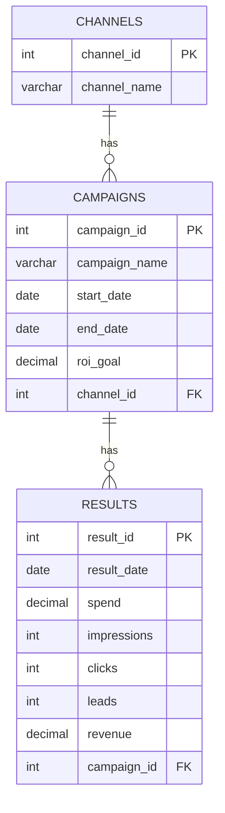

# Data Schema Notes

## ER diagram

## Table Purpose
- The Channels table stores data on its marketing channels that can be referenced by multiple campaigns.
- The Campaigns table stores data on its campaign's name, its start and end date, and its ROI goal. Many campaigns can reference one channel.
- The Results table stores data on its result date, spend, impressions, clicks, leads, and revenue. Many results can reference one campaign.

## Channels Being Its Own Table
- Without channels as its own table, each campaign would have to store the channel name as a varchar. Inconsistent spelling of a channel name creates duplicates of the same channel across different names. Additionally, it'd increase the possibility of entering a channel that does not even exist. A separate channels table allows each channel name to be stored once, and to be cleanly referenced by its channel_id.

## How The Foreign Keys Work
- The foreign keys allow a table to reference the primary key of another table. Through the foreign key, tables can be linked together and reference data from one another. The campaigns table has a channel_id foreign key that allows it to reference the channel_id from channels. The results table has a campaign_id foreign key that allows it to reference the campaign_id from campaigns. A foreign key also blocks bad data from entering the database by blocking the insert and throwing a foreign key constraint error if a parent row doesn't exist.

## How SQL Commands Checked The Design
- The DESCRIBE command was run for each table to look over and verify that columns and data types were accurate.
- The SHOW CREATE TABLE command was run for the campaigns and results tables to view and verify the correct foreign keys were in place.
- The SELECT * FROM channels command was run to view and verify the four channels were seeded into the channels table.
