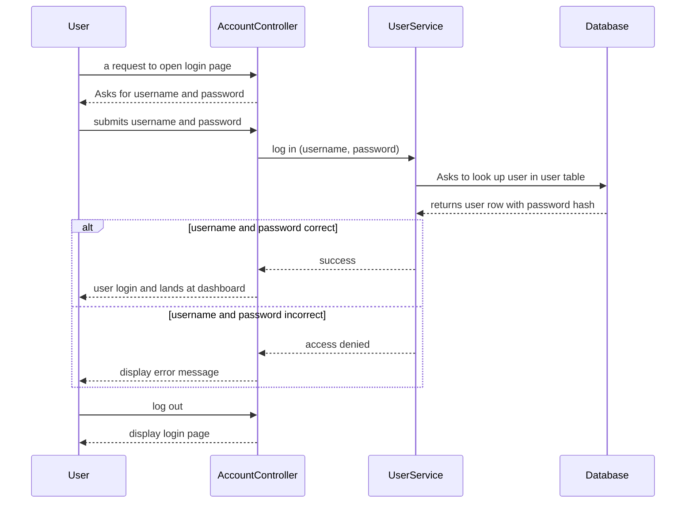
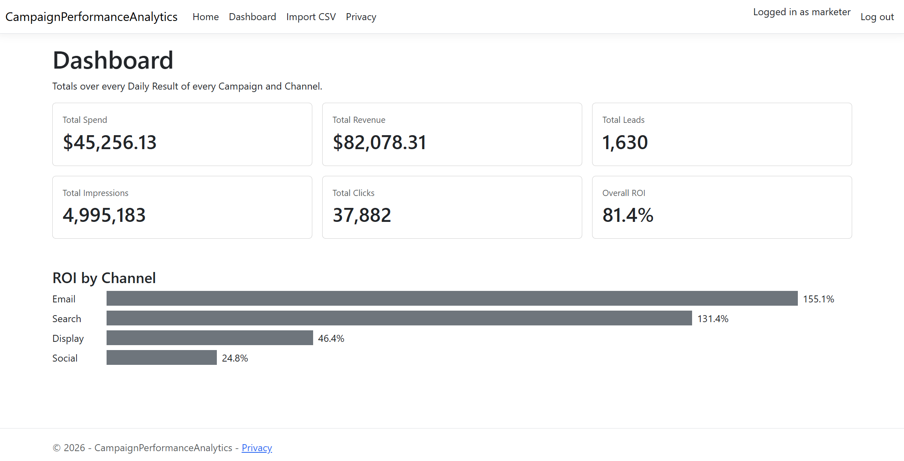
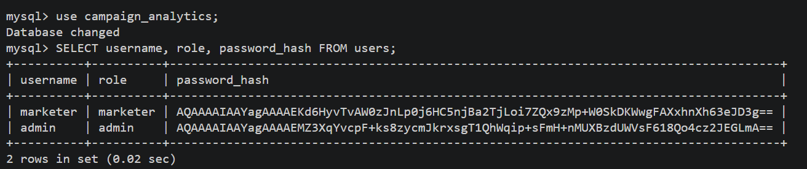
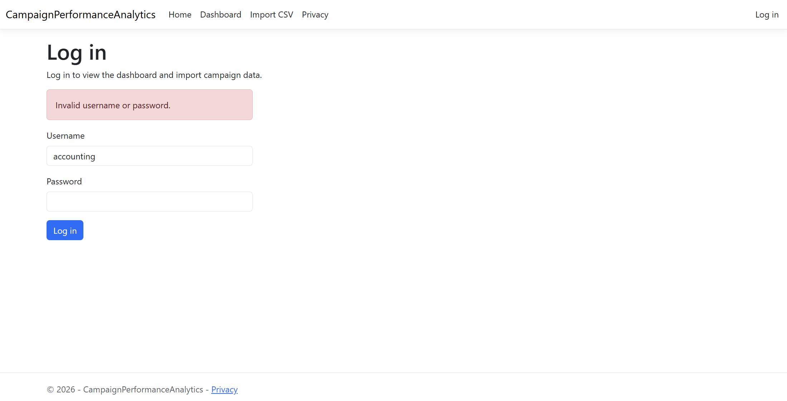
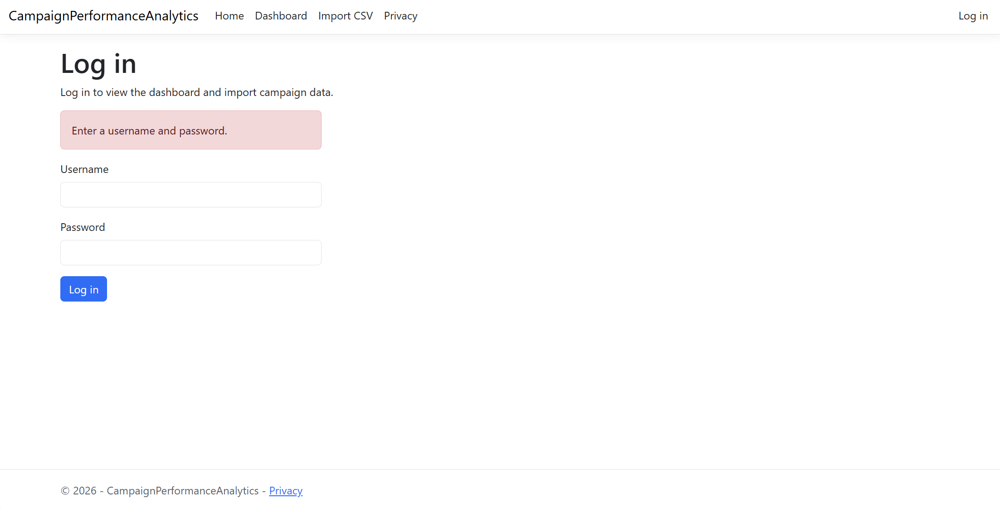
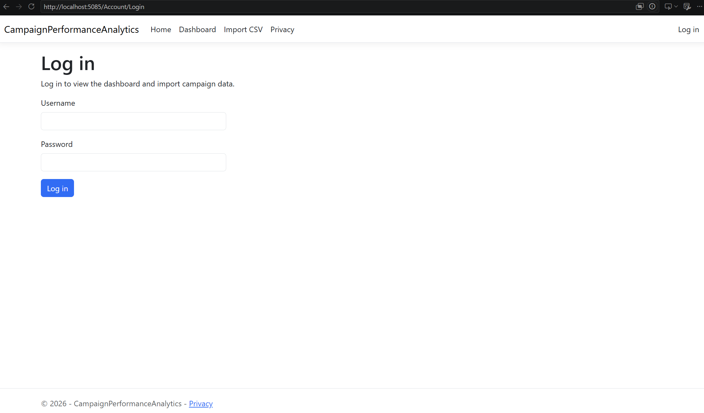
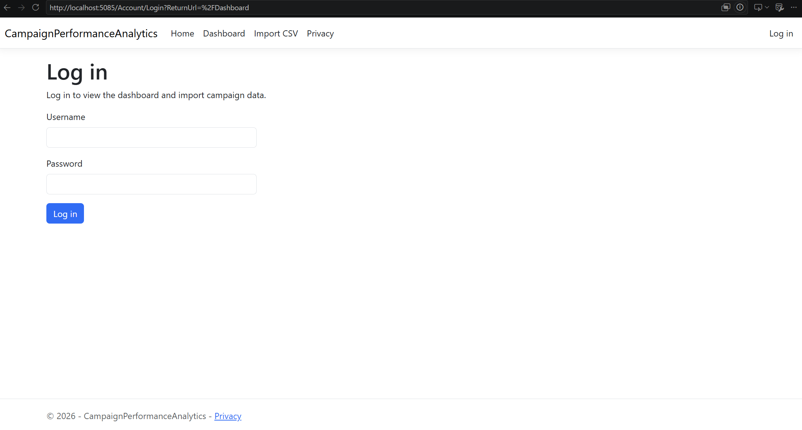
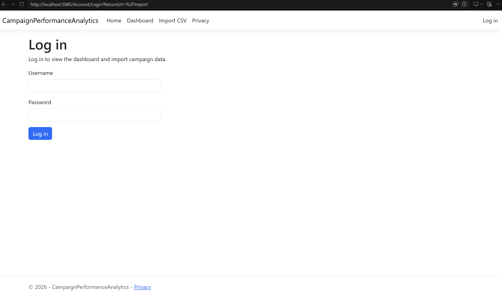

# Log In, Log Out Process Notes

## Sequence Diagram

## Relevant Screenshots

### Marketer login landing page with nav features such as user description and log out link

### Admin login landing page with nav features such as user description and log out link

### Password Hash SQL

### Invalid Username or Password

### Empty Username or Password

### Logged out

### Trying to access Dashboard without being logged in

### Trying to access Import CSV without being logged in

